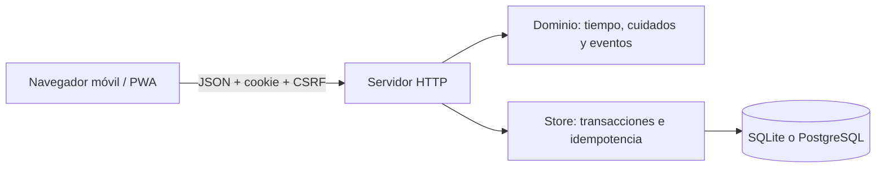

# Arquitectura del MVP

## Auditoría

Se inspeccionaron todos los archivos rastreados de `main`: `README.md` (título) y `prueba.txt` (mensaje de prueba). No existía aplicación, dependencias, pruebas, base de datos ni AGENTS.md. Se conserva `prueba.txt`. Base: commit `e7ba2dd8b6ae3ac4b69c82408df6325508b416b0`.

## Stack y estructura mínima

PWA HTML/CSS/JavaScript sin framework; servidor Node.js 24 LTS. SQLite con WAL mediante `node:sqlite` para local/volumen duradero; PostgreSQL mediante `pg` cuando existe `DATABASE_URL`. No hay compilación. La prueba gratuita usa PostgreSQL Free para evitar perder datos al reiniciar el servidor Free sin disco. Facilita validar en móviles sin tiendas. El SVG 2D provisional reduce coste y peso.

| Ruta | Responsabilidad |
| --- | --- |
| `public/` | Interfaz móvil, SVG, tarjeta PNG y shell PWA |
| `server/domain.mjs` | Reglas puras, etapas, personalidad y azar reproducible |
| `server/lab.mjs` | Simulación aislada reutilizando reglas de dominio |
| `server/store.mjs` | Esquema v1, SQLite y transacciones |
| `server/postgres-store.mjs` | PostgreSQL, pool y bloqueo por propietario |
| `server/app.mjs` | HTTP, validación, autenticación y estáticos |
| `server/index.mjs` | Configuración y ciclo de vida |
| `test/` | Dominio, HTTP y contratos contra SQLite/PostgreSQL reales |
| `scripts/` | Sintaxis e informe de métricas consentidas |
| `docs/` | Producto, reglas, decisiones y progreso |

## Datos y API

Tablas: `users` (UUID, creación, consentimiento), `sessions` (hash del token, CSRF, caducidad), `pets` (una por usuario, JSON de dominio), `events` (historial persistente; interfaz muestra hasta 40), `requests` (clave única y respuesta de comando), `metrics` (eventos opcionales sin nombres ni terceros).

`GET /api/session` consulta sesión y aviso de límites Free si corresponde; `POST /api/session` crea prueba; `GET /api/state` reconcilia y devuelve `serverNow`; `POST /api/adopt` recibe `{name}`; `POST /api/actions` recibe `{action}`; ambas mutaciones requieren `Idempotency-Key`. `POST /api/preferences` controla consentimiento. `GET /health` consulta la base seleccionada. No se permite elegir propietario, fechas, edad, recompensas o rasgos.

## Tiempo y consistencia

Nacimiento y acciones toman hora del servidor, nunca del teléfono. Se requiere host con hora sincronizada; `lastObservedAt` evita rejuvenecer si retrocede el reloj. Reconciliación al abrir/cuidar, sin cron por mascota. Cuidados, eventos, inventario e idempotencia se guardan en una transacción. SQLite serializa callbacks asíncronos y usa `BEGIN IMMEDIATE`; PostgreSQL usa `BEGIN` y `SELECT ... FOR UPDATE` sobre el propietario, incluso entre procesos. Una clave repetida devuelve la respuesta original sin duplicar. El cliente conserva la clave en `sessionStorage` ante pérdida de respuesta.

Los métodos del almacenamiento admiten `await`; el dominio sigue siendo puro. El pool PostgreSQL limita conexiones a cinco por proceso. La revocación de métricas relee consentimiento dentro de la transacción: un comando iniciado antes de revocar no vuelve a insertar métricas. Ambos backends mantienen iguales datos/reglas; no hay migración automática de SQLite a PostgreSQL.

Sorpresas con semilla mascota+ventana de seis horas; consultar más no aumenta oportunidades. Tras ausencia se considera solo la ventana actual, sin cascadas de premios. Evoluciones y objeto único quedan registrados.

## Seguridad y límites

Cookie aleatoria HttpOnly y SameSite=Lax; producción Secure. Token almacenado como SHA-256, sesión de prueba de 30 días sin recuperación entre dispositivos. JSON, origen exacto y CSRF en escrituras; sin CORS. Nombres validados y mostrados mediante `textContent`, CSP, límites de cuerpo y timeouts. Cooldowns y límite local de creación de sesiones; no se confía en cabeceras de proxy para IP.

El frontal debe gestionar HTTPS, conexiones abusivas y hora sincronizada. Falta autenticación permanente, exportación/eliminación completa de datos, política legal de privacidad y auditoría de seguridad antes de una beta pública amplia. No existen pagos. Las métricas internas con UUID son seudónimas, no anónimas.

## Operación y escalado

SQLite: un proceso y volumen duradero, con backups consistentes; no compartir el archivo entre réplicas. PostgreSQL: persistencia fuera del servidor web; preparar exportaciones y restauración, y gestionar migraciones de esquema al crecer. El arranque inicializa tablas v1 sin borrar datos. Para numerosas instancias todavía faltan límites distribuidos, observabilidad y pruebas de carga. No se declara capacidad masiva verificada.

`render.yaml` declara solo servidor y PostgreSQL Free, sin disco de pago. Esa base caduca a los 30 días y el servicio duerme por inactividad. `render-persistent.yaml` conserva la alternativa de pago separada. Ninguna configuración cancela ni migra un servicio previamente creado. No usar SQLite sobre disco efímero para prometer guardado permanente.

El service worker guarda solo el shell. No cachea API ni tokens, ni simula cuidados offline. Al desconectarse pide reconexión y no presenta datos locales como guardados.

## Laboratorio aislado

`sandboxes` almacena por usuario un documento con mascota, historial limitado a 40 y `virtualNow`. Es independiente de `pets`, `events` y `metrics`; las mutaciones conservan el bloqueo por propietario y la idempotencia. Los saltos son comandos predefinidos (incluido siguiente umbral), nunca un timestamp del cliente. El reloj solo cambia por comando; la cookie y sus permisos usan tiempo real. Iniciar reanuda si ya existe, reset sustituye solo la mascota ficticia. No hay permisos de administración de mascotas ajenas. Las tablas se añaden al arranque sin reescribir datos. Habilitación explícita `PETVERSE_DEVELOPER_TOOLS=true`; las rutas devuelven 404 cuando está apagada.
