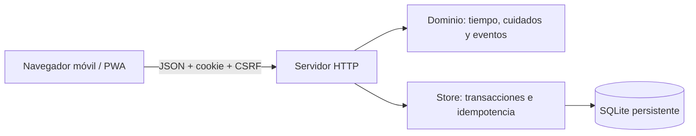

# Arquitectura del MVP

## Auditoría

Se inspeccionaron todos los archivos rastreados de `main`: `README.md` (título) y `prueba.txt` (mensaje de prueba). No existía aplicación, dependencias, pruebas, base de datos ni AGENTS.md. Se conserva `prueba.txt`. Base: commit `e7ba2dd8b6ae3ac4b69c82408df6325508b416b0`.

## Stack y estructura mínima

PWA HTML/CSS/JavaScript sin framework; servidor Node.js 24 LTS; SQLite con WAL mediante `node:sqlite`. Sin paquetes de producción ni compilación. Facilita validar en móviles sin tiendas. Una app nativa o 3D se reconsiderará si lo justifica el uso real. El SVG 2D provisional reduce coste y peso.

| Ruta | Responsabilidad |
| --- | --- |
| `public/` | Interfaz móvil, SVG, tarjeta PNG y shell PWA |
| `server/domain.mjs` | Reglas puras, etapas, personalidad y azar reproducible |
| `server/store.mjs` | Esquema v1, SQLite y transacciones |
| `server/app.mjs` | HTTP, validación, autenticación y estáticos |
| `server/index.mjs` | Configuración y ciclo de vida |
| `test/` | Dominio e integración HTTP sobre SQLite real |
| `scripts/` | Sintaxis e informe de métricas consentidas |
| `docs/` | Producto, reglas, decisiones y progreso |

## Datos y API

Tablas: `users` (UUID, creación, consentimiento), `sessions` (hash del token, CSRF, caducidad), `pets` (una por usuario, JSON de dominio), `events` (historial persistente; interfaz muestra hasta 40), `requests` (clave única y respuesta de comando), `metrics` (eventos opcionales sin nombres ni terceros).

`GET /api/session` consulta sesión; `POST /api/session` crea prueba; `GET /api/state` reconcilia y devuelve `serverNow`; `POST /api/adopt` recibe `{name}`; `POST /api/actions` recibe `{action}`; ambas mutaciones requieren `Idempotency-Key`. `POST /api/preferences` controla consentimiento. `GET /health` consulta SQLite. No se permite elegir propietario, fechas, edad, recompensas o rasgos.

## Tiempo y consistencia

Nacimiento y acciones toman hora del servidor, nunca del teléfono. Se requiere host con hora sincronizada; `lastObservedAt` evita rejuvenecer si retrocede el reloj. Reconciliación al abrir/cuidar, sin cron por mascota. Cuidados, eventos, inventario e idempotencia se guardan en `BEGIN IMMEDIATE`. Una clave repetida devuelve la respuesta original, sin duplicar; cambiar el comando de esa clave da conflicto. El cliente conserva la clave en `sessionStorage` cuando se pierde la respuesta y refresca estado después de un replay.

Sorpresas con semilla mascota+ventana de seis horas; consultar más no aumenta oportunidades. Tras ausencia se considera solo la ventana actual, sin cascadas de premios. Evoluciones y objeto único quedan registrados.

## Seguridad y límites

Cookie aleatoria HttpOnly y SameSite=Lax; producción Secure. Token almacenado como SHA-256, sesión de prueba de 30 días sin recuperación entre dispositivos. JSON, origen exacto y CSRF en escrituras; sin CORS. Nombres validados y mostrados mediante `textContent`, CSP, límites de cuerpo y timeouts. Cooldowns y límite local de creación de sesiones; no se confía en cabeceras de proxy para IP.

El frontal debe gestionar HTTPS, conexiones abusivas y hora sincronizada. Falta autenticación permanente, exportación/eliminación completa de datos, política legal de privacidad y auditoría de seguridad antes de una beta pública amplia. No existen pagos. Las métricas internas con UUID son seudónimas, no anónimas.

## Operación y escalado

Un proceso y un volumen persistente; backups SQLite consistentes y restauración probada. No compartir SQLite entre réplicas ni usar hosting estático. Para numerosas instancias: PostgreSQL, almacenamiento compartido para sesiones/límites y observabilidad. El dominio está separado para permitir esa migración. No se declara capacidad masiva verificada.

El service worker guarda solo el shell. No cachea API ni tokens, ni simula cuidados offline. Al desconectarse pide reconexión y no presenta datos locales como guardados.
